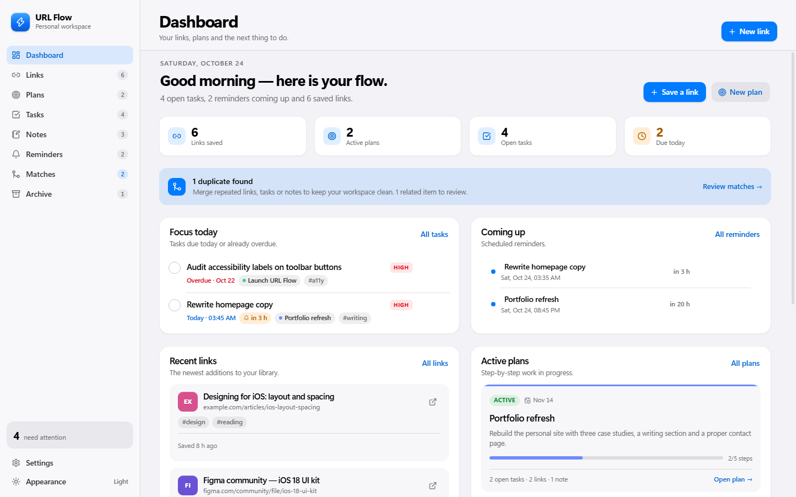
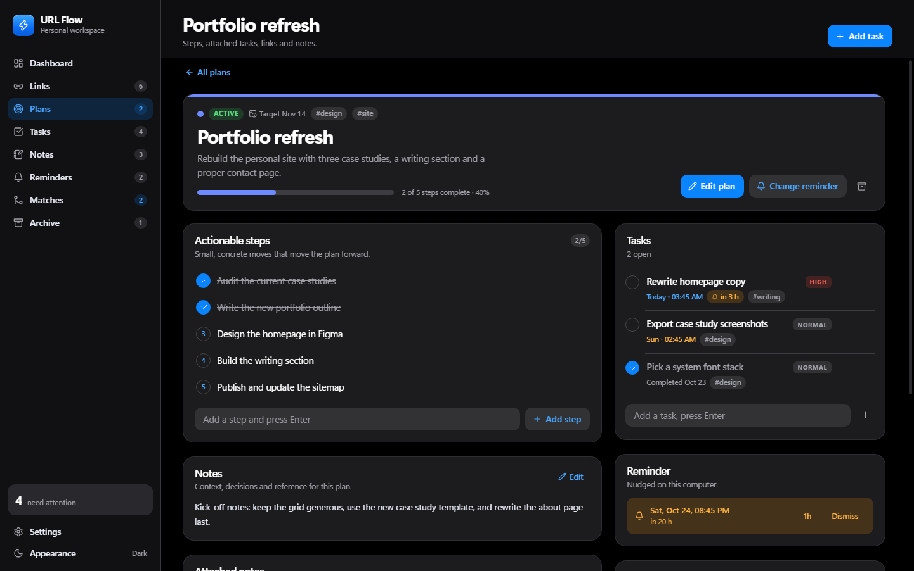

# URL Flow

A Windows desktop app for keeping track of the links you collect, the plans you are working through,
and everything around them: notes, steps, tasks, reminders, duplicate detection, merging and archiving.

Built with Electron, React and TypeScript. All data lives on this machine — no account, no cloud.

## Install

Two builds are produced in `release/`:

| File | Use it when |
| --- | --- |
| `URL-Flow-Setup-1.0.0.exe` | Normal install. Per-user, no admin rights, creates Start Menu and desktop shortcuts. |
| `URL-Flow-Portable-1.0.0.exe` | Run from a USB stick or without installing anything. |

Your data is stored in `%APPDATA%\URL Flow\url-flow-data.json`. Use **Settings → Data** to open that
folder, export a JSON backup, or import one. Backups are validated before they replace anything.

The app keeps running in the system tray so reminders still fire after you close the window
(this can be switched off in Settings).

## What it does

- **Links** — save a URL, fetch its page title automatically, add notes and tags, mark favorites,
  open in your default browser. The last-opened time is tracked per link.
- **Plans** — give a goal a summary, target date, colour and an ordered list of steps. Each step can
  carry a due date and notes, move up or down, or turn into a task in one click. Attach tasks, links and
  notes to the plan.
- **Tasks** — priorities, optional due dates, one-click completion, and grouping by plan.
- **Notes** — free-form notes with pinning, tags and search.
- **Reminders** — schedule a nudge for any link, plan, task or note, with daily, weekday, weekly or
  monthly repeats. A native notification fires at the scheduled time; snooze, dismiss, or see anything
  that came due while notifications were unavailable under Missed.
- **Matches** — finds duplicate and related items automatically: identical URLs, same page on a site,
  similar titles, and similar task or note wording. Ignore a suggestion to hide it.
- **Merging** — merge a match group into one item. Notes and steps combine, tags are de-duplicated,
  reminders move to the surviving item, and attached items are re-pointed instead of lost. For a pair,
  choose which title, notes and date survive before merging.
- **Archive** — archive anything instead of deleting it; archived items keep their content, are hidden
  from matching and the main lists, and can be restored at any time.
- **Undo and redo** — every change is reversible, not just the last toast action: `Ctrl+Z` and
  `Ctrl+Shift+Z` walk a 40-step history that survives the window being reloaded, including archives,
  merges, deletions, imports and reminder changes.
- **Command palette** — `Ctrl+K` finds any link, plan, task or note across the workspace, jumps between
  views, creates items and runs actions like export or backup.
- **Quick capture** — from anywhere in Windows, `Ctrl+Shift+Space` (or the tray menu) saves the link on
  your clipboard, reads its title and files it in one step.
- **Weekly review** — one screen walks through overdue tasks, links that went quiet, plans that stopped
  moving and pending duplicates, offering keep, archive, complete or reschedule.
- **Bookmark import** — read a Chrome, Edge or Firefox HTML export, tag links by their folder, and skip
  addresses already saved.
- **Automatic backups** — a snapshot of the workspace is written each day, the last seven are kept, and
  any of them can be restored from Settings (which is itself undoable).
- **Search, filters, dashboard** — per-view search, status tabs, tag filters, and a dashboard with what
  is due today and coming up.
- **Appearance** — starts in your Windows light or dark appearance, with a manual switch in the sidebar.

## Screens





Keyboard: `Ctrl+K` opens the command palette, `Ctrl+N` creates a new item of the current view's type,
`Ctrl+Z` / `Ctrl+Shift+Z` undo and redo, and `Ctrl+Shift+Space` captures the link on your clipboard
from anywhere in Windows.

## Development

```bash
npm install
npm run dev        # Vite renderer + Electron shell with hot reload
npm run typecheck  # TypeScript for the renderer and the Electron main/preload
npm run build      # production renderer bundle + compiled main process
npm run dist       # build and package the installer + portable exe into release/
```

Packaging uses the Electron runtime already installed in `node_modules/electron/dist`
(`build.electronDist` in `package.json`); reinstall dependencies to refresh it after an Electron upgrade.
